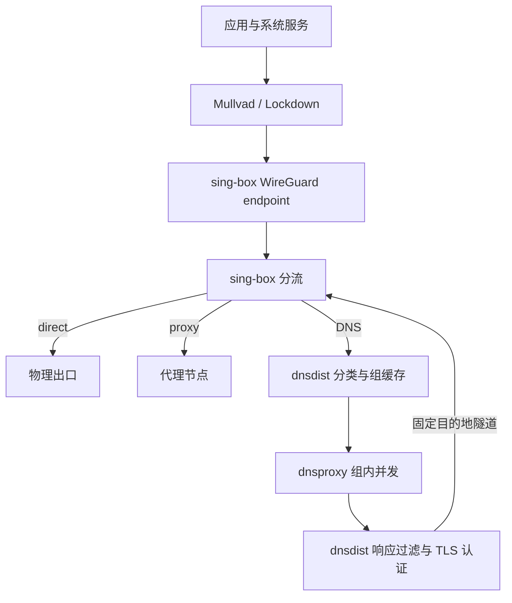
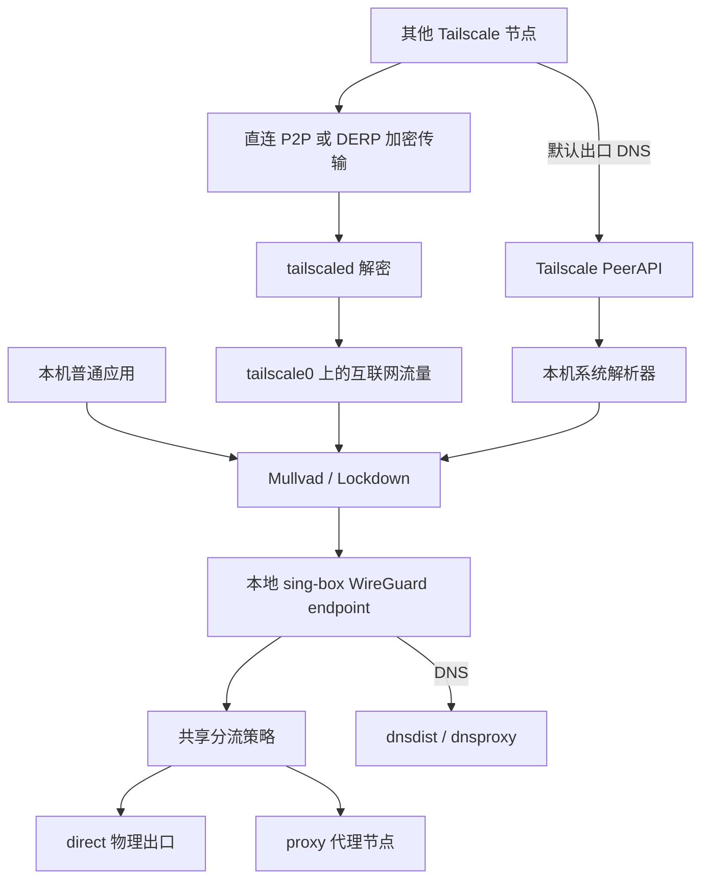

# 网络分流与 Lockdown

网络按三个开关组合，模块默认关闭，laptop profile 显式启用三项。域名规则由共享模型规范化，DNS 与连接路由分别消费。

| `dns.enable` | `singBox.enable` | `lockdown.enable` | 行为 |
| --- | --- | --- | --- |
| true | false | false | 系统 DNS 分流；CN/GLOBAL 通过物理网络访问各自的加密上游 |
| false | true | false | 10800 的 HTTP/SOCKS 显式代理，使用现有系统解析器 |
| true | true | false | 系统 DNS + 显式代理；CN 和节点 bootstrap 直接解析，GLOBAL DNS 经代理 |
| true | true | true | DNS + 整机透明分流 + Mullvad Lockdown |
| false | false | false | 使用主机原有网络与解析配置 |

开关位于 `site.network`。Lockdown 依赖 DNS 与 sing-box。sing-box 启用时始终监听 `0.0.0.0:10800`，供 HTTP/SOCKS 显式代理使用；双栈时另有 `[::1]:10800`。本机可用 `127.0.0.1:10800`，其他设备使用宿主对应网络的 IPv4 地址并遵守入站策略。显式代理和透明接管使用同一套分流规则。DNS-only 配置只需要域名规则和上游；代理模式另需要节点文件。

能力组合由 NixOS 配置选择。切换涉及 Lockdown 的组合时，构建新的启动代次并重启，使防火墙、策略路由和服务一起进入目标状态。日常域名规则与代理节点通过下述 `network-policy apply` 更新。

三项同时启用时，应用使用系统网络和 DNS。Mullvad 负责整机接管及 Lockdown，sing-box 的本地 WireGuard endpoint 接收隧道内的 TCP/UDP 并进行分流。dnsproxy 只访问 loopback 的 dnsdist 过滤入口，真实上游连接由 dnsdist 交给 sing-box 的固定目的地入口；sing-box 以排除身份创建物理出口连接，避免再次被 Mullvad 接管。



## 私网开发访问与公网入站

laptop profile 启用独立的 `site.network.localAccess.enable`。同一策略用于宿主服务和 Docker 发布端口：

| 来源或目的 | 行为 |
| --- | --- |
| RFC1918 IPv4：`10.0.0.0/8`、`172.16.0.0/12`、`192.168.0.0/16` | 双向原生通信，入站允许所有监听的 TCP/UDP 服务 |
| Tailnet | 允许访问宿主服务及 Docker 发布端口；遵守 Tailnet 的访问规则 |
| 普通 Docker bridge | 允许访问宿主所有监听的 TCP/UDP 服务；包括默认和自建 bridge |
| 公网来源 | 仅允许 NixOS 防火墙明确声明的端口 |
| 通知专用网络 | 使用通知服务自己的隔离规则 |

私网直连与 IPv4 广播、组播独立于 sing-box；停止代理后仍可访问局域网开发服务和使用 mDNS、SSDP、KDE Connect 等发现协议。组播只在应用选择的本地链路发送，不在 Tailnet 与 LAN 之间中继。宿主、普通 Docker bridge 和出口节点客户端的 TCP/UDP 53 查询仍由项目 DNS 接管，DNS 监听入口保留自己的来源限制。IPv6 私网不套用 RFC1918 的宽松策略。

服务需监听对应网络地址或 `0.0.0.0`；仅监听 `127.0.0.1` 的服务只供本机使用。KDE Connect 由应用目录提供，连接和发现使用私网规则。公网开放端口统一声明，例如：

```nix
networking.firewall.allowedTCPPorts = [ 8443 ];
networking.firewall.interfaces.enp0s20f0u1.allowedUDPPorts = [ 9999 ];
```

同样支持 `allowedTCPPortRanges`、`allowedUDPPortRanges`。Docker 的 `8443:443` 发布按宿主端口 `8443` 判断，容器端口 `443` 不构成公网授权。显式代理端口 10800 默认只向上述可信来源提供服务。

`inet site_local_access` 管理入站分类和回复标记。私网目的地优先查找原生路由；本地 WireGuard peer 的 `10.67.0.1` 是保留的内部 DNS 地址，始终使用隧道路径。获准的公网入站连接，其回复使用原生出口。开放的 UDP 服务端口有首次源地址选择规则，以支持绑定通配地址的服务器；从相同源端口主动建立的公网 UDP 连接仍受 Lockdown 约束。普通公网出站和出口节点的公网转发继续进入透明分流。

SSH 可在 `identity.sops.yaml` 的 `ssh.hosts` 或 `~/.ssh/hosts.d/*.conf` 中为特定 Host 声明显式代理：

```sshconfig
Host example-vps
  HostName vps.example.invalid
  ProxyCommand nc -x 127.0.0.1:10800 %h %p
  IdentityFile /etc/ssh/gpg.vps.0123456789ABCDEF.pub
```

OpenSSH 仅通过此 ProxyCommand 建立连接，代理不可用时连接失败；最终使用 direct 还是远程节点仍由 sing-box 的连接规则决定。

## 地址族与运行时切换

laptop profile 通过 `site.network.ipv6.enable = false` 默认使用 IPv4。需要 IPv6 时，可在本次启动期间启用；其他主机可通过同一选项声明自己的默认值。

```sh
sudo network-ipv6 status
sudo network-ipv6 on
sudo network-ipv6 off
```

`on` 临时启用双栈，`off` 临时关闭 IPv6；重启回到声明式默认值。`status` 显示启动默认值、临时覆盖、当前模式和各层实际状态。

双栈模式下，glibc 的地址排序表以及 sing-box 的本地目标与节点解析优先 IPv4。`prefer_ipv4` 保留 AAAA 回答，不决定应用的连接顺序：例如 curl 的 [Happy Eyeballs](https://curl.se/libcurl/c/CURLOPT_HAPPY_EYEBALLS_TIMEOUT_MS.html) 会优先尝试可用的 IPv6 地址。应用已选择的字面量 IPv6 地址会按该地址转发，远端节点需要具备 IPv6 出口。代理协议将域名交给远端解析时，远端独立选择地址族。

`off` 将本机及经本机转发的出口切为 IPv4：接口与 loopback 关闭 IPv6，inet/bridge 转发入口丢弃 IPv6；dnsdist 对 AAAA 返回 NOERROR 空回答，DNS listeners、bootstrap 和加密上游使用 IPv4，重启解析进程以清空缓存。sing-box 将域名目标先解析为 IPv4，再交给 direct 或代理，并拒绝字面量 IPv6 目标；节点拨号也只解析 IPv4。仅有 IPv6 地址的节点在此模式下不可达。Mullvad 使用仅含 IPv4 的本地 WireGuard peer；Tailscale 的控制、DERP、打洞和 P2P 使用 IPv4，其他节点仍可通过本机使用 IPv4 出口。

命令控制宿主和转发出口。容器或虚拟机内部的 IPv6 配置、已经缓存在其中的 AAAA 记录，以及远端代理服务器自身的网络配置，由各自环境管理。关闭期间经过本机出口的原生 IPv6 流量被阻断。

临时覆盖只记录在 `/run/site-network-policy/`，重启回到声明式默认值。物理连接由 NetworkManager 管理；重连、新接口出现、服务重启及 `network-policy apply` 继续遵守当前模式。NetworkManager 修改的是当前连接；启用 IPv6 时重新应用保存的连接配置，Wi-Fi profile 与凭据保持原样。Mullvad 通过原生 CLI 配置，启动连接时按当前模式重新应用。

切换期间会短暂重启 DNS、sing-box、本地隧道及已运行的 Tailscale，现有连接可能中断。先验证候选配置，再建立 IPv6 阻断并启用对应配置；启用双栈时先放行 `lo` 上源、目的地址均为 `::1` 的通信，让 DNS 和代理完成本地就绪检查，随后启动本地隧道及 Tailscale，再解除其余 IPv6 阻断。命令等待物理出口绑定、服务监听和隧道共同就绪后才报告成功。配置验证不通过时保留当前模式；切换开始后失败则恢复完整 IPv6 阻断（含回环），命令返回非零，`status` 显示 `incomplete`。检查相应 journal 后重新执行目标模式。`status` 同时检查接口、包过滤表、配置代次、消费者服务及 Mullvad 隧道状态。

失败信息保留具体阶段、命令及服务退出原因；`network-ipv6 status` 显示最近失败摘要和受限日志路径。原始输出在 `/run/site-network-policy/last-error.log`，结构化摘要在 `last-error.json`。恢复阻断或重启观察器时的附加错误与最初失败一起保存。

只有 DNS、DNS＋sing-box、完整 Lockdown 三种组合均使用相同入口。上游需要至少一个 IPv4 地址；仅有 IPv6 上游的分组无法生成 IPv4 配置。IPv4 模式的 AAAA 回答在 DNS 日志中标记为 `listener/ipv4-only`。

## 明文 DNS 接管

启用 DNS 后，本机、普通 Docker bridge 和 Tailscale 出口客户端发往任意地址 TCP/UDP 53 的查询进入本机解析体系，包括 `dig example.com @1.1.1.1` 和 `dig +tcp example.com @1.1.1.1`。DNS 模块提供本机持有的 `169.254.53.53` 和 `fd53:53:53::53` 入口；双栈时两个地址都可用，IPv4 模式只使用前者。接管在 Mullvad 的 DNS 过滤之前执行，DNS-only 模式也具有相同行为。

本地回环解析器、MagicDNS 和本地隧道的 DNS 地址保持各自路径。Compose 的服务名由 Docker 内嵌 DNS 处理，其公共查询进入本机体系。入口只接受本机、已发现的普通 Docker bridge 和 Tailscale 接口；通知专用网络使用自己的访问规则。DoH/DoT 按普通连接分流。

## Tailscale

`services.tailscale.enable` 独立控制 Tailscale。它使用系统 DNS，公共服务域名按 `15-tailscale-services.json` 进入 CN；MagicDNS 和 Tailnet 反向域查询直接访问 `100.100.100.100`。因此在完整组合中，公共 DNS 仍依赖共享解析服务及其传输。

| 模式 | 控制平面、DERP、STUN 与 P2P UDP | 应用访问 Tailnet 地址 | 其他节点通过本机上网 |
| --- | --- | --- | --- |
| Tailscale 单独启用，或搭配 DNS / 显式 sing-box | Tailscale 原生连接走物理网络 | Tailscale 原生路由 | 原生转发；DNS 启用时使用共享解析策略，显式代理仍由应用选择 |
| DNS + sing-box + Lockdown + Tailscale | `mullvad-exclude` 启动守护进程，走物理网络 | Tailnet 路由表优先于透明接管，数据进入 `tailscale0` | 与本机普通应用共用透明分流和 Lockdown |

主机决定是否公告出口节点和子网路由、是否接受远端路由。启用出口节点时，需要原生转发和 SNAT，并由管理端批准；实际可用的地址族遵循上述主机模式。`shields-up=false` 允许对端连接和出口转发。子网路由也需要管理端批准及访问规则允许；[laptop2 的选择](../hosts/laptop2/README.md)可作为现有实例。



出口节点收到的互联网流量经过内核转发，Tailscale 原生 SNAT 使用本地隧道地址进入 sing-box。连接返回时由 conntrack 恢复目标节点地址。公网转发使用 Mullvad 的隧道放行与故障阻断规则；访问本机的 Tailnet 连接、Tailscale 的底层传输及启用 `localAccess` 后的 IPv4 私网访问使用原生网络。代理节点不可达时，direct 仍可使用，proxy 保持阻断；分流服务或本地隧道不可用时，出口上网受阻，Tailnet 通信仍可使用。

Tailscale 默认将出口客户端的公共 DNS 查询通过 PeerAPI 交给出口节点的系统解析器，本项目再交给 dnsdist；MagicDNS 保留原生处理。客户端需启用 `accept-dns`，管理端另行指定的 “Use with exit node” nameserver 会改变默认路径。使用应用自带 DoH 时，其连接按普通应用流量处理。[出口节点 DNS 行为](https://tailscale.com/docs/reference/dns-in-tailscale)

`tailscale netcheck` 自身会创建诊断 socket。要观察 Lockdown 中守护进程使用的物理出口，用 `sudo mullvad-exclude tailscale netcheck`；`tailscale ping` 通过守护进程检测实际对端路径。

Lockdown 模式启动时，守护进程确认官方排除 cgroup 已就绪后运行；这一步由系统服务重试，不依赖 sing-box 的启动。

Tailscale 为底层 socket 设置的标记在首次路由查找时优先选择物理网络，从而使用正确的本机源地址。这样接收新的 UDP 探测后，回复仍属于同一条连接，NAT 打洞可以使用原端口。

出口标记链位于两者的 mangle 处理之后，保持 Mullvad 使用的完整连接排除标记。Tailscale 继续管理自身防火墙与路由；共享 conntrack 的处理顺序随依赖升级一起验证，相关上游行为见 [Tailscale 的连接标记讨论](https://github.com/tailscale/tailscale/issues/19787)。

Tailnet 地址范围为 `100.64.0.0/10` 和 `fd7a:115c:a1e0::/48`。规则只为该目标范围选择 Tailscale 表。入口的直连标记在本机 `input` hook 设置，互联网转发经过 `forward` hook；WireGuard UDP 入口仅匹配来自其他接口、目标为本机的传输包。禁用 Tailscale 时，MagicDNS 分类回到私有域处理。

```sh
tailscale status
tailscale netcheck
tailnet_peer=peer-name  # 换成对端的设备名或 Tailnet IP
tailscale ping "$tailnet_peer"
journalctl -u tailscaled -u site-tailscale-routes -b

# 在另一个客户端选择已获管理端批准的出口节点
exit_node=laptop2  # 换成已批准的出口节点
sudo tailscale set --exit-node="$exit_node" --accept-dns=true
```

## Docker 与 Compose

同时启用 Docker 和项目 DNS 时，Docker 的默认 DNS 指向宿主的 `169.254.53.53`。默认 bridge 直接使用它；Compose 和自建 bridge 保留 Docker 的 `127.0.0.11` 内嵌解析器，用于服务名解析并将外部查询转给宿主入口。已有容器需要重新创建，才能取得新的 DNS 默认值。

启用 `localAccess` 时，默认和自建 bridge 的容器可通过宿主网关访问所有监听的 TCP/UDP 服务，例如 `http://172.17.0.1:8765/`；网关可用 `docker network inspect` 查看。服务需监听网关地址或通配地址。公网访问 Docker 发布端口遵循上方的统一声明；通知专用网络继续使用独立限制。

宿主的构建缓存代理也可通过网桥供容器使用，监听和客户端配置见[缓存指南](cache.md#nixos-主机与容器)。

`site-container-network.service` 根据 Docker 网络清单和内核路由同步本地 bridge 的路由表与 DNS 访问规则，监听网络创建、连接、删除及接口变化。启用 IPv6 时，按 Docker 的 IPAM 配置恢复 bridge 的 IPv6 网关，现有容器继续使用原来的网络。宿主访问容器、容器服务名互通和已发布端口使用本地路径，Docker 继续管理端口发布、NAT、内部网络与网络隔离。互联网流量在完整组合中进入 sing-box 和 Mullvad Lockdown；DNS-only 与显式代理组合中按宿主原生路由转发，显式代理仍由应用自行选择。

路由表 `64500`、规则优先级 `94` 与 `inet site_containers` 防火墙表由同步服务管理，均为运行时状态；Docker 重启后重新读取网络清单。DNS 模块管理 `inet site_dns`，本地访问模块管理 `inet site_local_access`；同步服务更新其中的普通 bridge 集合。带 `org.nixos-config.service` 标签的通知专用网络使用通知模块自己的限制和路由。

IPv6 bridge 的邻居发现使用独立的规则：同步服务在 Mullvad 的 input/output/forward 链中管理带 `site-container-neighbors` 注释的规则，只允许 Docker bridge 上 hop limit 为 255 的邻居请求与通告，支持容器与网关、同桥容器之间的地址解析。它监听防火墙重建并重新同步，停止时删除这些规则；普通 TCP/UDP 出口继续遵循分流与 Lockdown。

```sh
systemctl status site-container-network systemd-resolved docker
journalctl -b -u site-container-network -u site-notification-network -u docker-prune -u docker
sudo docker network ls
sudo docker exec <容器名> cat /etc/resolv.conf
ip -4 route show table 64500
ip -6 route show table 64500
sudo nft list table inet site_containers
```

## 日常操作

```sh
sudo network-lockdown status
sudo network-lockdown disconnect
sudo network-lockdown connect
sudo network-policy check
sudo network-policy apply
systemctl status site-dns site-dns-race-cn site-dns-race-global sing-box
```

策略生成及原生校验在独立 systemd 文件系统和网络命名空间中执行，只读挂载工具与声明输入，只有候选输出目录可写。完成后由控制进程发布配置并操作预先声明的消费者服务。

`check` 校验已启用组件需要的输入；DNS-only 校验 DNS，代理模式同时校验实际节点。`apply` 生成新一代配置，按内容变化重启受影响的服务：修改节点只更新 sing-box，修改域名规则更新相应消费者，未变化的 DNS race 进程继续运行。新代次保存 0600 节点副本，服务通过 systemd credential 读取；在 30 秒总预算内检查本地服务及监听入口稳定就绪，预算包括探测命令和 socket 等待。失败时恢复上一代配置及节点，报告对应服务及退出状态；回退中的错误附在原始失败之后。退出限流的失败服务也可以通过有效配置的显式应用恢复。

启用 Lockdown 时，代理更新会暂停出口观察器，Mullvad blocker 和接管路由保持运行。校验失败保留正在使用的配置，校验输出保存在 root-only 的 `/run/site-network-policy/last-prepare.log`，最近失败及恢复过程记录在 `last-error.log`；磁盘输入修正后再执行 `apply`。服务重启读取已应用的代次，系统启动从持久输入重新生成。命令成功返回 0，输入/运行错误返回 1，用法错误返回 2。

`disconnect` 保持 Lockdown，停止代理并断开本地 WG。正常运行时 `direct` 是策略允许的出口；代理失效时 GLOBAL 保持阻断，分流服务整体停止时普通应用也被阻断。控制命令通过 sudo 操作。

## 规则文件与节点

| 入口 | 内容 |
| --- | --- |
| `site.network.routeFragments` | 共享的域名 route 片段 |
| `site.network.connectionFragments` | sing-box 原生连接 route 片段 |
| `/persist/usr/local/etc/network-policy/route.d/*.{json,jsonc}` | 本机共享域名片段 |
| `/persist/usr/local/etc/network-policy/connection.d/*.{json,jsonc}` | 本机连接片段，可按 IP、端口、协议或节点 tag 路由 |
| `/persist/usr/local/etc/sing-box/outbounds.json` | 原生 `outbounds` / `endpoints` 及凭据 |

所有可编辑 JSON 文件支持 JSONC 注释和尾逗号，包括保留 `.json` 扩展名的文件；生成物为严格 JSON。转换使用锁定 nixpkgs 的 HuJSON，源文件原样保留。

```sh
sudo install -d -m 0755 /persist/usr/local/etc/network-policy/route.d
sudo install -d -m 0755 /persist/usr/local/etc/network-policy/connection.d
```

route 文件直接包含 `rules`、`rule_set`、`final`，与 sing-box 的 `route` 对象相同。例如 `05-local.json`：

```json
{
  "rules": [
    {"domain": ["special.example.com"], "action": "route", "outbound": "proxy"},
    {"domain_suffix": ["ads.example.net"], "action": "reject"},
    {"domain_suffix": ["example.net"], "action": "route", "outbound": "direct"}
  ]
}
```

声明式写法使用相同内容：

```nix
site.network.routeFragments."05-local.json".rules = [
  { domain = [ "special.example.com" ]; action = "route"; outbound = "proxy"; }
];
```

每类片段先合并声明式和本机文件，同名本机文件替换整个声明式片段。随后把两类文件统一按文件名的 UTF-8 字节顺序排序，sing-box 消费全部规则，DNS 只消费共享规则，保持它们的相对顺序。两个目录不能使用相同文件名。每个文件的 `rules` 保持数组顺序，第一条命中的终止规则决定出口。

`final` 是没有规则命中时的兜底，不是该文件位置的一条匹配规则；每个消费者采用它可见的最后一个 `final`。rule-set tag 在合并后须唯一。空 `rules` 清空同名声明片段，删除本机文件恢复声明内容。系统 DNS 传输、嗅探、DNS 接管和明确阻断规则始终先于这些可配置片段。

默认片段也遵守同一顺序：

| 文件 | 内容 |
| --- | --- |
| `00-defaults.json` | `final = "proxy"` |
| `10-tailnet.json` | Tailscale 域名及反向域 → `tailnet`；未启用 Tailscale 时 → `private` |
| `15-tailscale-services.json` | `tailscale.com` / `tailscale.io` → `direct`，DNS 使用 CN |
| `20-private.json` | 私有域和私网反向域 → `private` |
| `70-geosite-global.json` | laptop 的 geolocation-!cn 规则集 → `proxy` |
| `80-geosite-cn.json` | laptop 的 geosite-cn 规则集 → `direct` |
| `90-cn.json` | `.cn` → `direct` |
| `95-tailnet-ip.json` | 启用 Tailscale 时，Tailnet IP → `tailnet` |
| `96-private-ip.json` | 私网 IP → `direct` |
| `97-direct-ip.json` | 已声明的 `directNetworks` → `direct` |
| `98-geoip.json` | 已声明的 GeoIP 规则集 → `direct` |

因此 `05-local.json` 可以覆盖私有域分类，`50-local.json` 位于私有域之后、订阅列表之前。重叠域名依据规则顺序选择；更长的后缀应按需要放到更早的规则中。`network-policy check` 输出实际文件顺序、来源和 `文件名/rules/索引`，索引从 0 开始。

节点文件的顶层为 `{"outbounds":[...], "endpoints":[...]}`，两类数组可分别省略，但合计至少提供一个具体节点。所有 tag 在两类数组和内置组件之间唯一。运行时由 `sing-box check` 校验原生字段，再发布 0600 配置与节点副本。

TLS 的路径字段遵循服务权限：引用的证书须位于 `sing-box` 用户可读的位置，且通过 `site.network.policyReadOnlyPaths` 开放给配置校验沙箱。私钥等敏感内容可使用原生 inline 字段放在 0600 节点文件中，由 systemd credential 交给服务。

OpenVPN 的 `tls.server_name` 使用 `verify-x509-name` 语义，默认精确匹配服务端证书的 CN。填写提供方指定的证书名称，它可以与连接地址不同。

独立 WireGuard 和 OpenVPN Client endpoint 可设置 `system: true`、`name: "foo"`，创建供特定应用绑定的系统接口。它们与普通 outbounds 一同进入 `auto` 和 `proxy` 的候选节点，也可在连接规则中直接引用其 tag；共享 DNS 仍使用 direct/proxy 等固定语义。示例结构如下，地址与凭据替换为提供方的实际配置：

```json
{
  "outbounds": [
    {"type": "socks", "tag": "primary", "server": "proxy.example.net", "server_port": 1080}
  ],
  "endpoints": [
    {
      "type": "wireguard", "tag": "private-wg", "system": true, "name": "foo",
      "address": ["10.88.0.2/32"], "private_key": "REPLACE_LOCALLY",
      "peers": [{"address": "wg.example.net", "port": 51820,
                 "public_key": "REPLACE_LOCALLY", "allowed_ips": ["0.0.0.0/0"]}]
    },
    {
      "type": "openvpn-client", "tag": "private-ovpn", "system": true, "name": "bar",
      "server": "vpn.example.net", "server_port": 1194, "network": "udp",
      "username": "REPLACE_LOCALLY", "password": "REPLACE_LOCALLY",
      "routes": ["0.0.0.0/0"],
      "tls": {"server_name": "REPLACE_WITH_SERVER_CERTIFICATE_CN", "certificate_path": "/persist/usr/local/etc/sing-box/vpn-ca.pem"}
    }
  ]
}
```

`system=true` 使用 sing-box 的接口作用域路由。Lockdown 下，endpoint 连接服务器的外层流量绑定已观察到的物理出口。普通应用仍按共享分流路径运行；显式绑定接口的应用需要由管理员授权进入 Mullvad 排除组，再降回普通用户：

```sh
sudo mullvad-exclude setpriv --reuid="$(id -un)" --regid="$(id -gn)" --init-groups \
  curl --interface foo --max-time 30 https://example.com/
```

上述授权限于这次命令及其子进程；系统没有向普通用户安装 setuid 排除入口。网络引擎本身以 `sing-box` 用户运行，持有创建 TUN 和管理该接口所需的网络能力。域名查询仍使用系统 DNS；私有站点的 endpoint 专用 DNS 不在共享策略中声明。


## 共享 route 子集

| 字段 | 匹配含义 |
| --- | --- |
| `domain` | 精确名称 |
| `domain_suffix` | 名称及子域；以 `.` 开头时只匹配子域 |
| `domain_keyword` | 域名中的字面子串 |
| `domain_regex` | 原生正则搜索；需要整串匹配时使用 `^`、`$` |
| `rule_set` | 引用一个或多个域名规则集 |
| `type = "logical"`、`mode = "and"/"or"`、`rules` | 显式组合匹配条件 |
| `invert` | 对当前条件或逻辑组合取反 |

名称采用小写 ASCII/IDNA，省略末尾的点。同一普通规则中的各 `domain*` 条件取 OR；`rule_set` 与其他条件的组合写成显式 logical 规则。嵌套规则只含匹配条件，最外层写终止动作。域名先转小写再匹配，正则本身遵循 Go/RE2 语义，包括显式大小写标志。编译工具把这一语义转换为 dnsdist 的 RE2 条件，sing-box 继续使用原始正则。

```json
{
  "rule_set": [{
    "type": "inline",
    "tag": "work",
    "rules": [{"domain_suffix": ["example.org"]}]
  }],
  "rules": [{
    "type": "logical", "mode": "and",
    "rules": [
      {"rule_set": ["work"]},
      {"domain_keyword": ["public"], "invert": true}
    ],
    "action": "route", "outbound": "direct"
  }]
}
```

规则集支持 `inline`、`local` 和 `remote`。本地文件使用绝对路径，格式为 `source` JSONC 或 `binary` SRS。source 文件采用 sing-box 的 `{"version":3,"rules":[...]}` 格式。应用时读取一次并固化为 inline 内容，DNS 与代理使用相同快照；后续文件修改通过 `network-policy apply` 生效。适合把本机规则集保存在 `/persist/usr/local/etc/network-policy/route.d/rulesets/` 下，与片段一同持久化、备份。

共享 `remote` 定义包含 `tag`、`format`、HTTP(S) `url` 和绝对路径 `initial_path`，下载、确认与应用流程见[规则来源与更新](#规则来源与更新)。连接片段中的 `remote` 使用 sing-box 原生配置和更新机制。

共享部分包含能在 DNS 查询阶段判断的域名条件。连接部分使用 sing-box 原生 `rules`、`rule_set` 和 `final`，由原生校验器检查格式；本地规则集可包含 IP 条件，同样在应用时固化其内容。`blockedNetworks` 属于系统阻断，`directNetworks` 和 GeoIP 是上述可排序的连接片段。

例如 `connection.d/30-work.jsonc` 可以早于订阅规则选择一个节点，同时保持 DNS 的共享域名分类：

```jsonc
{
  // tag 必须在 outbounds.json 的 outbounds 或 endpoints 中存在。
  "rules": [
    {"domain_suffix": ["example.org"], "port": [443], "network": "tcp", "outbound": "primary"},
    {"ip_cidr": ["203.0.113.0/24"], "outbound": "private-wg"},
  ],
}
```

### Clash API

`site.network.clash.enable = true` 启用 `127.0.0.1:9090` 的原生 API；端口由 `clash.port` 指定。`clash.secretFile` 指向运行时 bearer token 文件，默认 `/persist/usr/local/etc/sing-box/clash-secret`，由 systemd credential 提供。启用前准备非空 token 文件，由 root 持有、权限 0600；更换 token 后重启 `sing-box.service`。

`proxy` selector 提供 `auto` 和具体节点，选择保存在 `/var/lib/sing-box/cache.db`，重启后恢复。API 的模式只作为原生 `clash_mode` 条件使用；需要按模式切换路由时，在 `connection.d` 中声明相应规则并自行选择顺序。UI 可连接本机 API，系统只提供原生控制接口。

| 动作/出口 | DNS 绑定 | 连接路由 |
| --- | --- | --- |
| `route` → `direct` | CN 组 | 物理出口 |
| `route` → `proxy` | GLOBAL 组 | 代理节点 |
| `route` → `tailnet` | Tailscale DNS | tailscale0 |
| `route` → `private` | 本地 NXDOMAIN | direct 类型出口 |
| `reject` | 本地 NXDOMAIN | 拒绝连接 |

默认出口使用上述四个 outbound tag。`tailnet` 需要启用对应服务及绑定。上游、ECS 和监听端口由 `site.network.dnsPolicy` 配置，域名规则由 `routeFragments` 配置；DNS 独立运行时同样解释这些出口标签。

## 规则来源与更新

laptop profile 从 [lyc8503/sing-box-rules](https://github.com/lyc8503/sing-box-rules)下载规则。GeoSite 同时决定 DNS 分类和连接路由，由共享策略流程统一应用；GeoIP 由 sing-box 的[远程规则集](https://sing-box.sagernet.org/configuration/rule-set/)自动更新。两者通过现有代理下载。

GeoSite 在上次成功检查满 24 小时后下载，失败后每小时重试。下载和校验成功后保存为待应用版本，当前 DNS 和连接路由继续使用已应用版本。桌面通知可打开 Rofi 确认框，默认选择“稍后”；选择“立即应用”并完成系统认证后，DNS 与代理服务一起切换，现有连接可能需要重连。应用失败会恢复上一版。Sway/Plasma 可点击通知，i3 的 Dunst 使用中键点击；同一待应用版本每次登录提醒一次。

已应用版本、待应用版本与检查时间保存在 `/var/lib/site-network-rules`，跨注销、重启保留。更换系统代次时优先使用同一来源的已应用规则，待应用版本继续等待确认。GeoIP 每 24 小时由 sing-box 更新，使用 `/var/lib/sing-box/cache.db` 持久缓存，更新时直接调整匹配内容。

```sh
network-policy rules-status
sudo systemctl start site-network-rules-update.service  # 立即下载并校验
sudo network-policy apply-rules                        # 应用待确认版本
journalctl -u site-network-rules-update -u site-network-rules-schedule -b
```

`rules-status` 显示共享规则的已应用、待应用版本及最近检查结果。下载或校验失败时，两份有效版本均保留；详细错误见服务 journal 和其指出的受限日志。手动下载不受自动检查间隔限制。

flake 中的 GeoSite、GeoIP 输入提供首次启动可用的初始快照。日常更新由运行中的服务完成；[自动更新工作流](ci.md#入口和候选提交)让初始快照随其他输入升级进入系统代次。本机片段继续按同名替换和文件顺序生效。

## DNS 响应与缓存

每次缓存未命中同时询问组内分支，采用第一个合格响应：

| 响应 | 处理 |
| --- | --- |
| NOERROR，包括 NODATA；NXDOMAIN | 可以胜出 |
| SERVFAIL、REFUSED、FORMERR、扩展错误码 | 等待其他分支 |
| 传输或 TLS 身份失败 | 等待其他分支 |
| 所有分支失败 | 返回 SERVFAIL |

这是首个合格响应策略，NXDOMAIN 可能早于正常答案到达。CN 与 GLOBAL 使用独立缓存，临时错误不缓存；DNS 策略变化会重启分类入口并清空旧缓存。

ECS 默认 IPv4/IPv6 `/0`，客户端自带 ECS 被拒绝；有明确 CDN 定位需要时可设置固定前缀。公网上游使用认证 TLS，TLS 身份校验与 DNSSEC 是不同机制。

默认 CN 使用 AliDNS 的两个协议入口，GLOBAL 使用 Google DoT 和 Cloudflare DoH。修改 `site.network.dnsPolicy.groups.<name>.upstreams` 时提供字面地址、协议、端口及 TLS 名称。启用 sing-box 时，GLOBAL DNS 走代理，CN DNS 走 direct；节点域名由独立 CN bootstrap 解析，节点名称会暴露给该解析服务。DNS-only 模式的两组上游均直接访问。DNS + sing-box 模式下，代理退出仍可解析 CN，GLOBAL 返回失败。CN 两个入口属于同一提供商，仍有共同故障域。

## Lockdown 运行与故障定位

物理出口由 main 默认路由及真实网卡选择，接口或地址变化时先停止代理再更新绑定。Mullvad 断开或状态读取失败时停止代理。受排除的基础设施 sing-box 使用专用 cgroup 和受限能力，普通应用保持在保护路径内。这些出口绑定及故障处理由 Lockdown 模块管理。

Mullvad DNS 使用 `default` 模式，从本地自定义隧道取得网关地址。锁定版本会将 `custom` 模式中的私网 DNS 归入隧道外，故应保留这里的模式。[路由优先级定制](../nix/patches/mullvad-routing-priority.patch)使宿主显式声明的路由规则先于 Mullvad 的接管规则生效；升级 Mullvad 时需要复核这项关系。

本地 Mullvad 隧道和 sing-box 对端使用相同的 MTU 1280。连接入口在每次启动、重连时通过 `mullvad tunnel set mtu 1280` 显式应用，使这条本地链路保持 IPv6 所需的最小 MTU；Mullvad 对显式 MTU 不运行自动探测调整。对端位于回环地址，这项设置不改变外部代理协议的配置。

本地 peer 密钥及 Mullvad 设置持久化于 `/var/lib/site-network`，规则生成物位于 `/run/site-network-policy`。恢复时使用持久源文件和官方 CLI；升级 Mullvad 同时复核持久格式、路由及启动/断开场景。

透明入口处理 TCP/UDP，外部 ICMP 明确阻断；本地隧道地址响应 Mullvad 连通性检查。UDP 按目标地址和端口独立映射，同一 socket 访问不同目标时分别选择策略。域名分流依赖 DNS 关联或 HTTP/TLS 元数据，共享 IP、不透明 UDP、ECH 和应用自带 DoH 需要按实际流量确认。DHCP/多网卡漫游、休眠、真实网络的 NAT 条件，以及容器和 Waydroid 的转发路径在设备上验收；自动化场景见[验证指南](validation.md)。

## 日志与保留

DNS 事件由 dnsdist 原生 dnstap 经本地 UNIX socket 交给 DNS Collector，写入 `network` 命名空间的 `site-dns-events` journal。`site-dns`、两个 `site-dns-race-*` 和 `sing-box` 共用这个独立 journal。每个事件保留原始 DNS payload；解码后可以查看 RCODE、flags、问题和 AN/NS/AR 各区的名称、类型、TTL 与数据。命名空间的单行限额为 512 KiB，容纳大响应的结构化字段和完整报文编码。

| 标记 | 信息 |
| --- | --- |
| `dnstap.identity = dnsdist-client` | 客户端查询及响应；`extra` 包含命中的片段/规则位置、规则集来源、出口组及策略内容版本 |
| `dnstap.identity = dnsdist-leg` | 每条实际加密上游分支的查询和响应；`extra.upstream` 包含协议、地址、端口、TLS 名称 |
| `extra.response_source` | `query`、`upstream`、`cache` 或 `self`；本地 NXDOMAIN 和客户端 ECS 拒绝属于 `self` |

`extra` 是 JSON 字符串。查询响应还带 DNS ID、客户端地址/端口与时间；分支记录包含被丢弃的错误响应。前端的 `group` 表示策略选择的 CN/GLOBAL/Tailnet；原生 dnsproxy 并发日志没有贯穿所有进程的请求标识，因此同名并发或响应相同时，无法严格把每个客户端请求绑定到唯一竞速胜者。逐分支结果、实际返回内容和 dnsproxy 的上游日志分别保留。

```sh
# 完整 DNS 消息；--name 可选，按完整域名筛选
sudo journalctl --namespace=network -u site-dns-events -o cat --since '10 minutes ago' |
  network-dns-log --name example.com

# 实时结构化事件及已解码字段
sudo journalctl --namespace=network -u site-dns-events -o cat -f |
  jq -Rrc 'fromjson? | select(.dns.qname == "example.com") | {dns, policy: (.dnstap.extra | fromjson)}'

sudo journalctl --namespace=network -u site-dns -u site-dns-race-cn -u site-dns-race-global -f
sudo journalctl --namespace='*' -u sing-box -u mullvad-daemon --since today
sudo journalctl -k --since today | rg wireguard
sudo tail -F /var/log/mullvad-vpn/daemon.log
sudo journalctl --disk-usage
sudo journalctl --namespace=network --disk-usage
systemctl list-timers site-network-logrotate.timer
```

`network-dns-log` 输出逐行 JSON，`dns` 字段是完整 DNS 文本；可接 `jq -r '.dns'` 查看。dnsproxy 开启 verbose，sing-box 开启 debug，Mullvad 使用原生 `-vv` 调试级别。需要内核 WireGuard 调试时，可按需启用并在排查后关闭：

```sh
sudo sh -c "printf '%s\n' 'module wireguard +p' > /proc/dynamic_debug/control"
sudo journalctl -k -f
sudo sh -c "printf '%s\n' 'module wireguard -p' > /proc/dynamic_debug/control"
```

当前内核 WireGuard 的调试入口见 [官方说明](https://www.wireguard.com/quickstart/#debug-info)。用户态实现的日志位于 `/var/log/mullvad-vpn/wireguard.log`，与 daemon 日志一起轮转。

两个 journal 都保存在持久挂载的 `/var/log/journal` 下，各自按空间或时间先到者淘汰；保留天数是最长时间。网络服务继续输出完整 DNS、verbose/debug 日志，命名空间关闭速率丢弃。它的文件位于 `<machine-id>.network`，启动顺序等待持久挂载就绪。

| 日志 | 空间预算 | 单文件 | 最长保留 |
| --- | --- | --- | --- |
| 系统默认 journal：备份、登录、内核及其他服务 | 512 MiB | 32 MiB | 14 天 |
| `network` journal：DNS、竞速分支、sing-box | 4 GiB，启用压缩 | 64 MiB | 7 天 |

高频网络正文的轮转独立于备份和系统历史。服务管理器的生命周期消息仍可能出现在默认 journal；查询跨命名空间的服务时使用 `--namespace='*'`。

Mullvad 文件位于持久化的 `/var/log/mullvad-vpn`；每五分钟检查，每日或文件超过 16 MiB 时轮转，保留四份压缩归档，轮转时清理超过七天的归档。文件可能在检查间隔内超过阈值；`copytruncate` 保持打开的日志描述符和隧道运行，复制与截断之间存在短暂丢失窗口。Mullvad journal 与内核记录仍在默认命名空间。日志用于本机排障，Restic 精确路径策略备份规则与节点配置。
