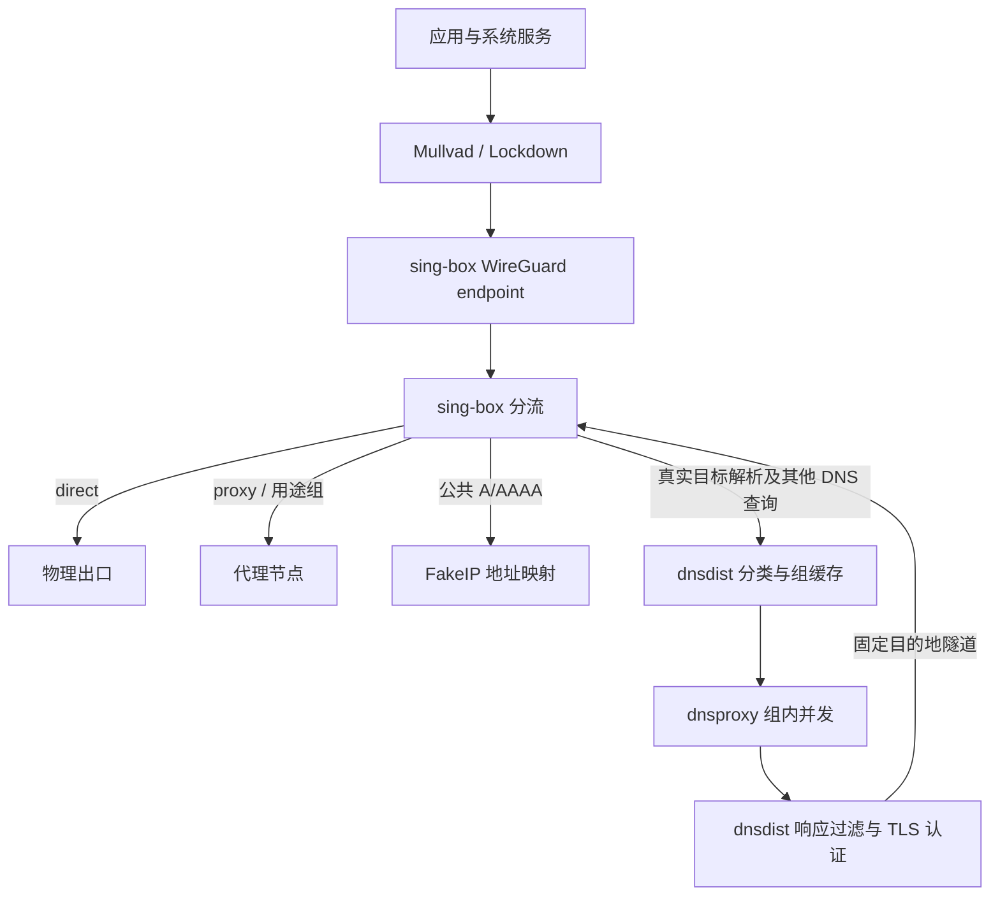

# 网络分流与 Lockdown

网络按三个开关组合，模块默认关闭，laptop profile 显式启用三项。域名规则由共享模型规范化，DNS 与连接路由共同消费。

| `dns.enable` | `singBox.enable` | `lockdown.enable` | 行为 |
| --- | --- | --- | --- |
| `true` | `false` | `false` | 系统 DNS 分流；CN/GLOBAL 通过物理网络访问各自的加密上游 |
| `false` | `true` | `false` | `10800` 的 HTTP/SOCKS 显式代理，使用现有系统解析器 |
| `true` | `true` | `false` | 系统 DNS + 显式代理；CN 和节点 bootstrap 直接解析，GLOBAL DNS 经代理 |
| `true` | `true` | `true` | FakeIP DNS + 整机透明分流 + Mullvad Lockdown |
| `false` | `false` | `false` | 使用主机原有网络与解析配置 |

开关位于 `site.network`，Lockdown 依赖 DNS 与 sing-box。sing-box 启用时监听 `0.0.0.0:10800`（双栈另含 `[::1]:10800`）提供 HTTP/SOCKS 显式代理，来源范围遵循入站策略，显式代理与透明接管共用同一套分流规则。切换涉及 Lockdown 的组合时，使用 `nixos-rebuild boot` 重启生效；日常域名规则、节点和地址族切换通过下述运行期命令即时生效。



网络栈按三方职责协作：

- **Nix 声明层**：负责 DNS 拓扑、Mullvad Lockdown 保护策略、`sing-box` 稳定配置骨架、服务依赖与保护性策略路由。
- **运行期控制面**（`network-policy`、`site-network-underlay`、`network-ipv6`）：负责跟踪物理链路变化、合并本机节点与规则片段、在无网络且只读输入的独立沙箱中执行原生校验、原子切换生效代次并在异常时自动回退。
- **维护者本机输入**：`/usr/local/etc/sing-box/outbounds.json` 中的代理节点与凭据、`/usr/local/etc/network-policy/{route.d,connection.d}` 中的个人规则片段，以及外部代理节点自身的连通性由维护者负责。

## 日常操作与排障

### 状态检查、策略应用与 Lockdown 控制

```sh
sudo network-policy status
sudo network-lockdown status
sudo network-lockdown disconnect
sudo network-lockdown connect
sudo network-policy check
sudo network-policy apply
sudo network-ipv6 status
network-policy rules-status
systemctl status site-dns site-dns-race-cn site-dns-race-global sing-box site-network-underlay
```

`sudo network-policy status` 只读汇总物理接口与网关（`/run/site-network-underlay/underlay.json`）、Mullvad 隧道状态、IPv6 模式、当前生效策略代次、共享规则更新状态、消费者服务 `ActiveState`，以及存在失败记录时的阶段摘要与日志路径（`/run/site-network-policy/last-prepare.log`、`last-error.log`）。

候选策略生成与原生校验在无网络、只读输入的独立 systemd 命名空间中完成，随后由控制进程原子切换 `/run/site-network-policy/current` 并按实际配置哈希变化重启受影响的消费者服务（仅改节点只重启 `sing-box`，未变化的 DNS race 进程保持运行）。校验失败保留当前运行配置，校验详情写入 root-only 的 `/run/site-network-policy/last-prepare.log`，激活异常与回退记录写入 `last-error.log` 与 `last-error.json`。

开启 Lockdown 且物理网络暂未连接（`underlay.json` 为空）时，`network-policy apply` 与 `network-ipv6` 同样允许验证并切换策略代次与地址族状态，暂不拉起 `sing-box`；待物理链路恢复后，基于 `ip monitor` 事件驱动的 `site-network-underlay.service` 自动绑定物理接口并启动 `sing-box`。

`disconnect` 停止 `sing-box` 并断开本地隧道，同时保持 Mullvad Lockdown 阻断，防止未保护直连外泄；`connect` 恢复本地隧道与分流。命令成功返回 `0`，运行/校验错误返回 `1`，参数错误返回 `2`。

### 按症状排障

| 症状 | 首查命令 | 重点观察与下一步 |
| --- | --- | --- |
| 切换 Wi-Fi 后全部断网 | `sudo network-policy status`、`nmcli device status` | 核对物理接口状态、`underlay.json` 网关与 Lockdown 隧道状态，再按下方顺序查底层与 `network` 命名空间日志 |
| 单个域名失败或走错出口 | `resolvectl query --cache=no <域名>`、`dig @127.0.0.1 -p 5300 <域名> A` | 区分应用侧 FakeIP 与本机真实解析，再用 `network-dns-log` 定位命中规则、解析组与出口 |
| 修改了节点或个人规则未生效 | `sudo network-policy check`、`sudo network-policy apply` | 校验失败查 `/run/site-network-policy/last-prepare.log`，激活或回退异常查 `last-error.log` |

1. **切换 Wi-Fi 后全部断网**
   - 在宿主机终端执行 `nmcli device status`、`sudo network-lockdown status` 与 `sudo network-policy status`，核对无线网卡是否 `connected`、`/run/site-network-underlay/underlay.json` 是否已记录当前物理接口和网关，以及 Mullvad 是否处于本地隧道连接态。
   - 若物理链路已连接但底层绑定或隧道未恢复，在系统默认 journal 中检查物理探测与守护进程：`sudo journalctl -u site-network-underlay -u mullvad-daemon -n 80 --no-pager`。
   - 若底层接口与 Lockdown 正常，在 `network` 命名空间 journal 中检查解析与分流进程：`sudo journalctl --namespace=network -u site-dns -u site-dns-race-cn -u site-dns-race-global -u sing-box -n 80 --no-pager`。
2. **单个域名失败或走错出口**
   - 在宿主机终端执行 `resolvectl query --cache=no example.com` 观察应用侧返回：启用 FakeIP 时，公共域名的 `A`/`AAAA` 直接返回 `198.18.0.0/15`（双栈含 `2001:2::/48`）映射地址，代表查询已进入透明接管路径而非真实上游结果。
   - 执行 `dig @127.0.0.1 -p 5300 example.com A` 直接请求本机 `dnsdist` 真实解析端口，确认对应解析组能否拿到有效上游记录。
   - 执行 `sudo journalctl --namespace=network -u site-dns-events -o cat --no-pager --since '10 minutes ago' | network-dns-log --name example.com`，观察输出中命中的片段文件名、规则下标、解析组 `group`（`cn` / `global`）与目标 `outbound`。
   - 对照 `sudo journalctl --namespace=network -u sing-box -n 80 --no-pager` 与显式代理测试（`curl -v --proxy http://127.0.0.1:10800 https://example.com/`）确认所选出口节点的实际连通性。
3. **修改了节点或个人规则**
   - 编辑 `/usr/local/etc/sing-box/outbounds.json` 或 `/usr/local/etc/network-policy/{route.d,connection.d}` 后，在宿主机终端运行 `sudo network-policy check` 预演片段合并顺序、规则语法与出口引用，确认通过后再执行 `sudo network-policy apply` 原子切换。
   - 准备或原生校验失败时当前生效代次保持不变，读取 `/run/site-network-policy/last-prepare.log` 查看具体语法或引用报错；切换期间服务启动失败触发自动回退时，读取 `/run/site-network-policy/last-error.log` 与 `last-error.json`。

### 日志查询与保留

DNS 事件由 dnsdist 原生 dnstap 经 UNIX socket 交给 `go-dnscollector`，写入独立 `network` 命名空间的 `site-dns-events` journal；`site-dns`、`site-dns-race-*` 与 `sing-box` 共用该命名空间，单行限额 512 KiB。

```sh
# 按完整域名筛选并解码 DNS 报文与命中规则来源
sudo journalctl --namespace=network -u site-dns-events -o cat --since '10 minutes ago' |
  network-dns-log --name example.com

# 实时查看结构化事件与策略元数据
sudo journalctl --namespace=network -u site-dns-events -o cat -f |
  jq -Rrc 'fromjson? | select(.dns.qname == "example.com") | {dns, policy: (.dnstap.extra | fromjson)}'

sudo journalctl --namespace=network -u site-dns -u site-dns-race-cn -u site-dns-race-global -f
sudo journalctl --namespace='*' -u sing-box -u mullvad-daemon -u site-network-underlay --since today
sudo tail -F /var/log/mullvad-vpn/daemon.log
sudo journalctl --disk-usage
sudo journalctl --namespace=network --disk-usage
```

| 标记或日志源 | 说明 |
| --- | --- |
| `dnstap.identity = dnsdist-client` | 客户端查询与响应；`extra` JSON 含命中片段/规则位置、规则集来源、解析组 `group`、用途 `outbound` 及策略版本 |
| `dnstap.identity = dnsdist-leg` | 加密上游分支查询与响应；`extra.upstream` 含协议、地址、端口、TLS 名称 |
| `extra.response_source` | `query`、`upstream`、`cache` 或 `self`（本地 NXDOMAIN 与客户端 ECS 拒绝属于 `self`） |
| 系统默认 journal | 512 MiB 上限、单文件 32 MiB、最长 14 天（承载备份、登录、内核与服务生命周期） |
| `network` journal | 4 GiB 上限、启用压缩、单文件 64 MiB、最长 7 天 |
| `/var/log/mullvad-vpn` | 每 5 分钟检查，按日或超 16 MiB `copytruncate` 轮转，保留 4 份压缩归档（最长 7 天） |

需要内核级 WireGuard 报文排查时，可临时执行 `printf 'module wireguard +p\n' | sudo tee /proc/dynamic_debug/control`，排查完毕改为 `-p` 关闭。

## 临时排除应用与 shell

`network-exclude` 让指定命令或交互 shell 通过原生物理网络出站，并使用返回真实地址的独立加密 DNS，同时保留当前工作目录、用户身份、环境变量与 SSH agent；进入交互式排除 shell 时，Starship 通过读取 `/proc/self/cgroup` 中的 `mullvad-exclusions` 标记在提示符前显示粗体红色 `[DIRECT]`：

```sh
network-exclude                         # 进入当前用户的排除 shell（提示符显示 [DIRECT]）
network-exclude curl https://example.com/
network-exclude --dns tls://1.1.1.1 -- curl https://example.com/

# 调整本次开机期间排除环境与 site-direct 容器共用的 DNS
network-exclude dns set tls://223.5.5.5 https://223.6.6.6/dns-query
network-exclude dns show
network-exclude dns reset
systemctl status site-network-exclude-dns
```

排除环境的共用 DNS 和引导解析器默认读取 `direct` 组。`dns set` 立即更新 `/run` 中的共用 DNS 列表，重启后恢复声明值。`--dns` 为当次命令建立临时解析器，命令退出后即回收。[DNS 上游声明](../data/network/dns-upstreams.toml)

桌面提供 `firefox-direct` 和 `google-chrome-direct`（均支持 `--dns SERVER`），保留 Firejail 沙箱并使用持久化的独立配置与缓存目录，经排除网络直接走物理网卡，可与普通受保护浏览器并行运行（区别于 `firefox-origin`：`firefox-origin` 仅隔离浏览器资料目录，网络仍走系统透明分流与 FakeIP）；无终端启动鉴权失败或已有实例占用同一配置文件锁时通过桌面通知提示。

## 地址族与运行时切换

laptop profile 默认声明 `site.network.ipv6.enable = false`，开机在联网前阻断 IPv6；运行期可随时临时切换：

```sh
sudo network-ipv6 status
sudo network-ipv6 on
sudo network-ipv6 off
```

- **双栈模式（`on`）**：glibc 地址排序与 sing-box 解析均优先 IPv4；应用连接 IPv6 FakeIP 恢复域名后仍可按目标支持情况走 IPv4 或 IPv6 出口。
- **纯 IPv4 模式（`off`）**：主机接口与回环禁用 IPv6（udev 自动忽略瞬态 `veth*`，其余热插拔与重连由 `site-network-ipv6-reconcile.service` 合并防抖并带失败自动重试），转发层丢弃 IPv6；dnsdist 对 `AAAA` 返回 `NOERROR` 空回答；sing-box 强制 `ipv4_only` 解析并拒绝字面量 IPv6；Mullvad 与 Tailscale 均切为纯 IPv4 运行。
- 切换过程先校验候选配置，再原子更新包过滤、服务监听与隧道就绪状态；若中途失败则自动恢复完整 IPv6 阻断并在 `status` 中报告 `incomplete` 与 `last-error.log` 路径。

## 用途出口与 Clash API

`site.network.purposeRouting.enable` 加载 [purposes.toml](../data/network/purposes.toml) 中的有序规则目录（laptop profile 默认启用）：

1. 先拦截 `pcdn`，再将 SSH/RDP（常见端口及嗅探出的协议）按真实公网 IP 分流：国内 `direct`、其余 `hideme`。
2. 匹配 `downloads`（GitHub Releases/GHCR、Nix/语言包仓库、系统镜像、Google 共享存储等），再处理 DoH 域名与 TCP 853（国内 IP `direct`，其余 `hideme`）。
3. 依次匹配各业务用途（`cryptocurrency`、`ai`、`payment`、`streaming`、`apns`、`social`、`hideme`、`tiktok`、`google`、`microsoft`、`apple`），随后处理中国企业海外 `@!cn` 例外（`proxy`）、国内推送 SDK 与 `cdn.jsdelivr.net`（`direct`）、Cloudflare/Fastly（`proxy`），再到 `.cn` 与 `geosite-geolocation-cn`（`direct`）、`geosite-geolocation-!cn`（`proxy`）。
4. 未命中的带域名连接统一进入 `hideme`；纯 IP 连接按 Telegram/Tor、流媒体、社交、APNs、`geoip-cn`（`direct`）匹配后兜底至 `hideme`。

通过 [VPS 订阅](vps.md#订阅与客户端导入) 下载 `?client=linux`（及 `&mode=trojan` / `&mode=trojan-chain` 备用配置）保存到 `site.network.providerFile`（root `0600`）；链式模式在同一目录放置提供 `CHAIN` 出站的 `chain.json`（root `0600`）。

在 `/var/lib/site-network/selections.json` 中可将任意用途持久固定到订阅允许的逻辑出口（仍在该出口的多条路径间自动测速择优）：

```json
{"proxy": "edge-native", "cryptocurrency": "west-native"}
```

编辑后执行 `sudo network-policy check && sudo network-policy apply` 生效。

### Clash API

`site.network.clash.enable = true` 在 `127.0.0.1:9090`（`clash.port`）启用原生控制接口，从 `clash.secretFile`（默认 `/usr/local/etc/sing-box/clash-secret`，root `0600`）加载非空 Bearer token。

- **分组 provider（含 `groups`，如 VPS 订阅）**：`render.py` 用各用途选择器（`proxy`、`hideme`、`downloads`、`ai` 等）及对应的 `自动 · <出口>` 测速组替代内置平面 `proxy`/`auto` 组。在 Clash API 中可直接打开任一用途组固定具体路径或切回自动择优；别名用途（如 `payment: hideme`）跟随目标组选择，对应 DNS 隧道同步走同一选择器。
- **非分组 provider（仅含 `outbounds` / `endpoints`）**：保留内置 `proxy`（含 `auto` 与全部节点）选择器，未单独绑定的用途组默认指向 `proxy`。

节点手动选择保存在持久化的 `/var/lib/sing-box/cache.db` 中，跨重启保留。

## 规则文件、节点与独立接口

| 入口 | 内容 |
| --- | --- |
| `site.network.routeFragments` | 声明式共享域名 route 片段（同时作用于 DNS 与连接分流） |
| `site.network.connectionFragments` | 声明式 sing-box 原生连接 route 片段 |
| `/usr/local/etc/network-policy/route.d/*.{json,jsonc}` | 本机共享域名片段（与声明式片段同名时整份替换该文件） |
| `/usr/local/etc/network-policy/connection.d/*.{json,jsonc}` | 本机连接片段（支持 IP、端口、协议或具体节点 tag；同名整份替换） |
| `/usr/local/etc/sing-box/outbounds.json` | 运行时 `outbounds` / `endpoints` 节点与凭据（支持 JSONC） |

两类片段合并后按文件名的 UTF-8 字节顺序统一排列（`route.d` 与 `connection.d` 之间不使用同名文件；本机目录与声明式片段同名时整份替换对应声明文件），首个命中的终止规则生效，`final` 采用对应消费者可见的最后一个定义。laptop profile 默认片段顺序如下：

| 文件 | 内容 |
| --- | --- |
| `00-defaults.json` | 初始 `final = "proxy"` |
| `10-tailnet.json` | `ts.net` 及 Tailnet 反向域 → `tailnet`（未启用 Tailscale 时 → `private`） |
| `15-tailscale-services.json` | `tailscale.com` / `tailscale.io` → `direct`（DNS 走 CN） |
| `20-private.json` | 本地域与私网反向域 → `private` |
| `20-unmapped-fakeip.json` | 启用 FakeIP 时，未还原出域名的 `198.18.0.0/15`、`2001:2::/48` 流量 → `reject` |
| `21-tailnet-ip.json` | 启用 Tailscale 时，无域名的 Tailnet IP → `tailnet` |
| `22-private-ip.json` | 无域名的私网 IP → `direct` |
| `40-purpose-*.json` | 共同策略的有序域名与连接规则及规则集；将 `final` 设为 `hideme` |
| `97-direct-ip.json` | `site.network.directNetworks` → `direct` |
| `98-geoip.json` | `site.network.ipRuleSets` → `direct` |

个人例外按目标优先级选择文件名前缀：在 UTF-8 字节序中，`30-local.json` 排在 `20-private.json` 之后、`40-purpose-*.json` 之前，适合覆盖共享业务分流规则而保留私有域保护；`05-local.json` 则排在 `10-tailnet.json` 与 `20-private.json` 之前。

### 独立系统接口（`endpoints`）

`outbounds.json` 的 `endpoints` 可声明 `system: true`、`name: "foo"` 的独立 WireGuard 或 OpenVPN Client 接口（TLS CA 文件如需路径引用，将其加入 `site.network.policyReadOnlyPaths`；OpenVPN `tls.server_name` 默认精确匹配服务端证书 CN）：

```json
{
  "endpoints": [
    {
      "type": "wireguard", "tag": "private-wg", "system": true, "name": "foo",
      "address": ["10.88.0.2/32"], "private_key": "REPLACE_LOCALLY",
      "peers": [{"address": "wg.example.net", "port": 51820,
                 "public_key": "REPLACE_LOCALLY", "allowed_ips": ["0.0.0.0/0"]}]
    }
  ]
}
```

- 在**分组 provider** 中，此类 `endpoints` 不会混入 `proxy` 或用途测速组，专供 `connection.d` 规则按 `tag` 显式引用，或由排除进程通过 `--interface` 按需绑定：`network-exclude curl --interface foo https://example.com/`。
- 在**非分组 provider** 中，`endpoints` 的 tag 会与普通 `outbounds` 一同加入内置 `auto` 和 `proxy` 候选列表。

## 共享 route 子集与规则更新

共享域名规则支持 `domain`、`domain_suffix`（`.` 开头仅匹配子域）、`domain_keyword`、`domain_regex`（Go/RE2 语义）、`rule_set`、`type = "logical"`（`and`/`or`）与 `invert`。规则集支持 `inline`、`local`（绝对路径 `source` JSONC 或 `binary` SRS，应用时固化快照）及 `remote`（含 `tag`、`format`、`url`、`initial_path`）。

| 动作/出口 | 真实 DNS 解析绑定 | 连接路由 |
| --- | --- | --- |
| `route` → `direct` | CN 组 | 物理出口 |
| `route` → `proxy` / 用途组 | GLOBAL 组（经对应选择器隧道） | 对应选择器 |
| `route` → `tailnet` | Tailscale DNS（`100.100.100.100`） | `tailscale0` |
| `route` → `private` | 本地 `NXDOMAIN` | `direct` 类型出口 |
| `reject` | 本地 `NXDOMAIN` | 拒绝连接 |

首次启动使用 Flake 锁定的 GeoSite/GeoIP 离线种子。运行期间，`site-network-rules-schedule.timer` 在距上次成功满 24 小时后后台下载并校验共享域名规则集（失败每小时重试），生成待确认版本并通过桌面通知提醒；点击通知在 Rofi 中确认“立即应用”后切换 DNS 与 `sing-box`。也可在命令行操作：

```sh
network-policy rules-status
sudo systemctl start site-network-rules-update.service
sudo network-policy apply-rules
journalctl -u site-network-rules-update -u site-network-rules-schedule -b
```

## FakeIP 与异常退出恢复

完整组合默认启用 `site.network.dns.fakeIP.enable`（池为 `198.18.0.0/15` 与 `2001:2::/48`，持久化于 `/var/lib/sing-box/cache.db`）：

- 公共域名的 `A`/`AAAA` 返回 FakeIP，`HTTPS`/`SVCB` 返回 `NOERROR` 空回答以保持连接走 FakeIP，`TXT`/`MX`/`SRV` 转发真实记录；本地域、MagicDNS 与 Tailscale 控制域名保留真实解析。
- 需向所有应用返回真实 IP 的特定域名可写入 `site.network.dns.fakeIP.excludeFile`（JSONC `{"domain": [...], "domain_suffix": [...]}`），编辑后执行 `sudo network-policy apply`。
- 若遇断电或强杀导致 `cache.db` 丢失部分 FakeIP 映射，`20-unmapped-fakeip.json` 会直接 `reject` 未还原出域名的 `198.18.0.0/15` 和 `2001:2::/48` 连接，防止未知流量落入私网直连；若旧 FakeIP 已被新域名复用，重启受影响应用（或依次执行 `sudo network-lockdown disconnect`、清理客户端 DNS 缓存、`sudo network-lockdown connect`）即可重新解析恢复。

## 私网开发访问与公网入站

laptop profile 启用 `site.network.localAccess.enable`，统一作用于宿主服务与 Docker 发布端口：

- **RFC1918 IPv4（`10.0.0.0/8`、`172.16.0.0/12`、`192.168.0.0/16`）、Tailnet 与普通 Docker bridge**：允许双向原生通信及访问宿主监听的 TCP/UDP 服务（含局域网 mDNS/KDE Connect 发现与 `10800` 显式代理）；IPv6 私网不套用宽松放行。
- **公网来源**：仅放行 `networking.firewall.allowedTCPPorts` / `allowedUDPPorts`（及对应接口规则）显式声明的宿主端口；Docker `-p 8443:443` 按宿主端口 `8443` 判定。

## 明文 DNS 接管与加密竞速

启用 DNS 后，本机、普通 Docker bridge 与 Tailscale 出口节点客户端发往任意外部地址 TCP/UDP 53 的明文查询均被重定向至本机 `169.254.53.53`（双栈另含 `fd53:53:53::53`）。

缓存未命中时，dnsproxy 对组内所有加密分支并发查询，等待预算为 4 秒。首个返回的 `NOERROR`（含 `NODATA`）或 `NXDOMAIN` 胜出。`SERVFAIL`、`REFUSED` 或 TLS 失败会留待其他分支完成，全部失败时返回 `SERVFAIL`。默认拒绝客户端自带 ECS，对外发送 `/0`。CN 默认直连 `direct` 组的 DoH 和 DoT 端点，GLOBAL 默认并发查询 Google DoT 与 Cloudflare DoH。[DNS 上游声明](../data/network/dns-upstreams.toml)

## Tailscale

`services.tailscale.enable` 独立控制 Tailscale。在完整 Lockdown 组合下：

- `tailscaled` 经 `mullvad-exclude` 与 `run_excluded.py`（同时校验 cgroup v1 `net_cls` 与 cgroup v2 `mullvad-exclusions`）启动，控制面、STUN、DERP 与 P2P UDP 直接走物理网卡；
- `site-tailscale-routes.service` 在透明接管之前安装策略路由：优先级 `80/81` 让带 `0x80000/0xff0000` 标记的 Tailscale 底层套接口查询 `main` 表（无路由时 `unreachable` 闭合阻断），优先级 `90/91` 让目标为 `100.64.0.0/10` 与 `fd7a:115c:a1e0::/48` 的连接查询 Tailscale 表 `52`（表空时同样 `unreachable`，不落入公网隧道）；`inet site-tailnet` 表在 `output`/`prerouting`/`input` 同步维护 Mullvad 所需的 `ct mark 0xf41`；
- 其他设备将本机选为 Exit Node 时，其互联网流量与 PeerAPI 公共 DNS 查询进入本机透明分流、FakeIP 与 Lockdown 保护路径。

```sh
tailscale status
sudo mullvad-exclude tailscale netcheck
tailscale ping <peer-name-or-ip>
journalctl -u tailscaled -u site-tailscale-routes -b
```

## Docker 与 Compose

启用 Docker 与项目 DNS 时，默认 bridge 直接使用 `169.254.53.53`，自建/Compose bridge 保留 `127.0.0.11` 解析服务名并将外部查询转交宿主。`site-container-network.service` 实时同步网桥路由表 `64500`（优先级 `94`）、`inet site_containers` 及双栈网桥的 IPv6 邻居发现放行规则。

Lockdown 启用时自动创建 `site-direct` 网络，加入其中的容器直接走物理网络并使用 `network-exclude dns` 管理的解析器：

```sh
docker run --rm --network site-direct IMAGE COMMAND
systemctl status site-container-network docker
sudo nft list table inet site_containers
```

## 时间同步与 Lockdown 运行边界

laptop 与 VPS 均使用 `chrony` 经 [nts-servers.nix](../lib/nts-servers.nix) 执行 NTS 认证校时（状态保存在 `/var/lib/chrony`，通过 `chronyc sources` 与 `chronyc authdata` 查看）。

Lockdown 模式下，`site-network-prepare.service` 在 `mullvad-early-boot-blocking.service` 与 `mullvad-daemon.service` 之前验证或初始化 `/var/lib/site-network` 中的保护种子（跨 Mullvad 版本保留有效 `settings.json` 并由守护进程迁移，在连接阶段通过官方 CLI 强制设定 `lockdown-mode on`、`lan block` 与本地隧道 `mtu 1280`）。[mullvad-routing-priority.patch](../nix/patches/mullvad-routing-priority.patch) 保证宿主显式策略路由先于 Mullvad 接管规则生效。
