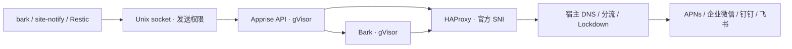

# 本地通知

`site.notifications` 提供完整 Apprise API 和 Bark 后端。普通用户通过本地 Unix socket 发送，通道地址与密钥来自 SOPS；官方 API 由宿主 HAProxy 按固定 SNI 转发，TLS 在应用与官方服务之间建立。



## 使用

```sh
bark '任务完成'
bark '标题' '中文正文'
bark '工作' '标题' '中文正文'
bark '工作' '标题' '中文正文' 'glass'
site-notify send --channel bark --channel wecom --title '结果' '中文正文'
```

`bark` 的一至四个参数分别为 `BODY`、`TITLE BODY`、`GROUP TITLE BODY`、`GROUP TITLE BODY SOUND`；两参数形式同时以标题作为 group。sound 使用 Bark 支持的声音名称。`site-notify` 输出每个通道的投递结果，全部成功返回 0，投递失败返回 1，参数错误返回 2。

HTTP 入口为 `/run/site-notifications/send.sock`，只允许 `site-notifications` 组和 root。`POST /notify/local` 接收原生 Apprise JSON：

```json
{"title":"标题","body":"内容","tag":"bark","format":"text","template":{"group":"工作","sound":"glass"}}
```

凭据和目的地在固定配置中，调用方只提供正文、标题、已配置的 tag 和 group/sound。选择多个通道时逐个投递到全部选中通道，某个通道失败不会跳过后面的通道，也不把第一个成功当作全部完成。每个通道最多尝试三次，间隔 1、2 秒，每次请求超时 30 秒；没有持久发送队列。响应丢失时重试可能产生重复通知。

Restic 的 backup、check、restore-test、maintenance 各自记录成功、失败或中断结果；因时间窗口、供电、成功间隔或本地锁而跳过时不发送通知。消息包含主机、目标别名、操作和结果。

备份通知在各仓库的持久状态目录中，仅保留每类操作的最新待发送结果。独立的 `site-backup-<target>-notify` 服务在作业结束后尝试发送，开机后及每 5 分钟补发；逐通道确认，已送达的通道不因另一通道失败而重发。投递过程中产生新结果时，旧结果的确认不会清除新结果。停机时该服务最多等待 5 秒，待发送结果留到下次启动。网络响应丢失或确认前停机仍可能导致重复投递。

`backup-status` 的 `notifications` 字段显示最近投递及待发送状态，详细操作历史保留在本机 journal。Restic 任务的停止流程只落盘结果，通知服务独立访问网络；通知失败不会改变备份的成功记录。

## 额外通道

`system.sops.yaml` 中的 `notifications/channels` 是原生 Apprise YAML 字符串。为每个通道指定 tag，然后通过 `site.notifications.backupChannels` 选择备份通知接收者。

```yaml
notifications:
  channels: |
    urls:
      - wecombot://REPLACE_WEBHOOK_KEY:
        - tag: wecom
      - dingtalk://REPLACE_SIGNING_SECRET@REPLACE_ACCESS_TOKEN:
        - tag: dingtalk
      - feishu://REPLACE_WEBHOOK_TOKEN:
        - tag: feishu
```

以上 token 均为占位文字，需从对应组织的机器人管理页获取。支持企业微信机器人与应用、钉钉机器人、飞书机器人；按 [Apprise 企业微信](https://appriseit.com/services/wecombot/)、[企业微信应用](https://appriseit.com/services/wechat/)、[钉钉](https://appriseit.com/services/dingtalk/)、[飞书](https://appriseit.com/services/feishu/)的字段说明填写。当前锁定的飞书插件没有签名 secret 参数，要求签名的机器人需要等待对应支持，不能按普通 webhook 示例配置。

Bark 自带的 APNs 签名实现由上游包提供；个人 device token 只挂载到 Bark。API 不持有这个 token，只知道内部 Bark selector。额外通道的凭据只挂载到 API。配置更新后通过 SOPS 的 restartUnits 重建凭据挂载并重启容器。

## 隔离与维护

两个容器使用锁定 nixpkgs 的 gVisor netstack，非 root UID、只读根文件系统、空 capabilities、no-new-privileges 和有限 tmpfs。API 初始限额 512 MiB，Bark 256 MiB，各 1 CPU。API 用一个 Gunicorn worker；初始化和插件导入同样发生在容器内。

HAProxy 只转发允许的官方域名和端口，不解密 TLS。它把受限容器的出站连接变成宿主普通连接，让既有 DNS、分流和 Lockdown 统一决定出口；容器本身无需获得任意互联网连接能力。

内部 Docker bridge 默认使用 `172.31.255.0/29`。如与现有网络重叠，在主机设置 `site.notifications.networkPrefix`。仅允许 API 到 Bark 的固定端口，以及各自到宿主 TLS 转发入口；官方地址使用静态 hosts，容器 DNS 不向外解析。宿主普通进程只能通过发送 socket 访问 API。官方连接由 HAProxy 新建，适用宿主的 DNS、sing-box 与 Lockdown；本地桥接通信使用明确的路由和连接标记。

Docker 每周执行原生自动 prune，使用默认 flags：清理停止的容器、未使用网络、悬空镜像和构建缓存，卷不在默认清理范围。`live-restore` 在兼容的 daemon 重启期间尽量保持容器运行，系统关机和应用服务明确停止仍会结束容器。默认 `local` 日志驱动提供按大小轮转的容器 stdout/stderr 日志，使用 `docker logs` 查看；新默认值用于新建容器。

镜像由 Nix 构建，内置最终 `security.pki.caBundle`；证书包变化更新镜像和对应服务。Apprise 与 Apprise API 由配套的 `flake=false` 输入锁定，分别按两个 Python 叶子包构建，其余依赖使用 nixpkgs binary cache。升级时先在 `flake.nix` 选择兼容的发布 tag，再更新并验证：

```sh
nix flake update apprise apprise-api
nix build --no-link .#checks.x86_64-linux.vm-backup
```

[上游 API 的环境变量](https://appriseit.com/api/reference/environment/)定义配置锁、身份验证、服务集合及附件限制。

桌面用户属于 rootful Docker 管理组，具有等同 root 的管理能力，可以读取容器凭据。容器权限限制针对其中的应用进程。

## 查看状态

```sh
systemctl status site-notification-secrets site-notification-network docker-site-apprise docker-site-bark haproxy
journalctl -u docker-site-apprise -u docker-site-bark -u haproxy
sudo docker logs site-apprise
sudo docker logs site-bark
backup-status
```

先检查凭据准备与容器启动，再检查宿主 DNS、分流出口和官方响应。日志默认不启用 debug。`journalctl -u site-backup-r2-notify` 查看该仓库的投递过程；详细 Restic 日志保存在各仓库的私有状态目录。
